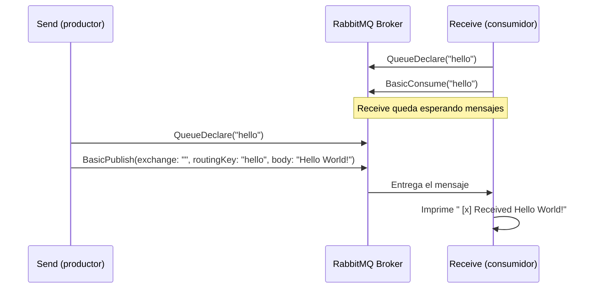

# RabbitMQDemo

Ejemplo mínimo de mensajería con [RabbitMQ](https://www.rabbitmq.com/) en .NET, basado en el tutorial "Hello World". La solución contiene dos aplicaciones de consola independientes:

- **Send**: publica un mensaje en la cola `hello`.
- **Receive**: se suscribe a la cola `hello` y procesa los mensajes recibidos.

## Requisitos

- .NET 10 SDK
- Un broker de RabbitMQ accesible en `localhost` (por ejemplo, vía Docker: `docker run -it --rm --name rabbitmq -p 5672:5672 -p 15672:15672 rabbitmq:3-management`)

## Cómo ejecutar

1. Levanta el broker de RabbitMQ.
2. En una terminal, ejecuta el receptor: `dotnet run --project Receive`
3. En otra terminal, ejecuta el emisor: `dotnet run --project Send`

Cada ejecución de `Send` publica `"Hello World!"` en la cola `hello`; `Receive` queda escuchando y lo imprime en consola apenas llega.

## Diagrama de flujo

Ambas apps declaran la misma cola (`hello`) de forma idempotente antes de usarla, por lo que el orden de arranque no es estrictamente relevante salvo que `Receive` esté escuchando antes de que `Send` publique, para no perder el mensaje (la cola es no durable y el consumo usa `autoAck: true`).
